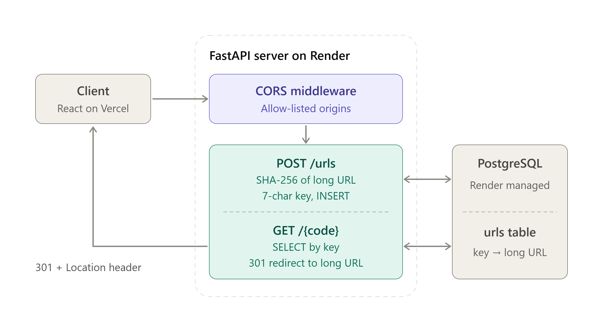

# Kutty URL

Kutty URL is a URL shortening service with a Vite frontend, FastAPI backend, and SQLAlchemy persistence. Users can create short links, open them through the public Vercel URL, and delete them by entering a short URL or key.

## Live Architecture



The deployed architecture consists of:

- **Frontend:** Vite static frontend hosted on Vercel
- **Backend:** FastAPI service hosted on Render
- **Database:** PostgreSQL managed by Render
- **Request protection:** FastAPI CORS middleware with configured frontend origins
- **Public redirects:** Vercel rewrites short paths to the Render backend

The diagram labels the client as React. The current implementation uses Vite with vanilla JavaScript, while the API and deployment flow remain the same.

## Application Screenshot


## Functional Requirements

- Accept a valid long URL from the user.
- Accept an optional custom short key.
- Generate a deterministic SHA-256-based short key when no custom key is supplied.
- Return the existing database row when the same long URL is submitted again.
- Reject a custom key that is already assigned to another URL.
- Display the newly created public short URL.
- Redirect a short key to its stored long URL using HTTP 302.
- Delete a short URL using either its key or full short URL.
- Provide a `HEAD /` health endpoint for uptime monitoring.
- Support browser requests from configured frontend origins through CORS.

## Non-Functional Requirements

- **Availability:** The backend should expose a lightweight health endpoint for monitoring.
- **Performance:** Short-key lookup uses an indexed, unique key column.
- **Consistency:** Repeated submissions of the same long URL return the existing record instead of creating duplicates.
- **Security:** Database credentials remain in hosting environment variables and are not included in the frontend bundle.
- **Scalability:** The API is stateless; persistent URL data is stored in PostgreSQL.
- **Maintainability:** Backend, frontend, and deployment configuration are separated into distinct directories.
- **Compatibility:** The frontend is responsive and can be built using the standard Vite build command.
- **Observability:** UptimeRobot can monitor `HEAD /` on the Render service.

## Storage Design

The backend uses SQLAlchemy with the `urls` table:

| Column | Type | Description |
| --- | --- | --- |
| `id` | Integer | Primary key |
| `Key` | String | Unique short key used for redirects |
| `Value` | String | Original long URL |
| `isactive` | Boolean | Active-state flag |
| `exptime` | String | Expiration value reserved for future use |
| `clicks` | Integer | Click counter reserved for future use |

### Database Configuration

- **Production:** Set `DATABASE_URL` to the Render PostgreSQL internal connection URL.
- **Local development:** If `DATABASE_URL` is not set, the backend falls back to `sqlite:///./database.db`.
- Render receives the PostgreSQL driver through `psycopg[binary]` in `Backend/requirements.txt`.

## API Endpoints

| Method | Endpoint | Description |
| --- | --- | --- |
| `GET` | `/` | Returns the API welcome response |
| `HEAD` | `/` | Health check for uptime monitors |
| `GET` | `/urls` | Lists stored URLs |
| `POST` | `/urls` | Creates or returns an existing short URL |
| `GET` | `/{short_key}` | Redirects to the original URL |
| `DELETE` | `/{short_key}` | Deletes a stored short URL |

### Create Request

```json
{
  "Value": "https://example.com/article",
  "Key": "optional-key"
}
```

`Key` is optional. If omitted, the backend generates a six-character hexadecimal key from the SHA-256 hash of `Value`.

## Environment Variables

### Backend on Render

```text
DATABASE_URL=<Render PostgreSQL internal URL>
FRONTEND_URL=https://kuttyurl.vercel.app
PYTHON_VERSION=3.11.11
```

### Frontend on Vercel

```text
VITE_API_BASE_URL=https://url-shortner-9rxt.onrender.com
```

`VITE_API_BASE_URL` is public because it is used by browser code. It must contain only the backend URL, not a database connection string or secret.

## Local Development

### Backend

```bash
cd Backend
python -m pip install -r requirements.txt
uvicorn main:app --reload --port 8000
```

The API is available at `http://localhost:8000` and its interactive documentation is available at `http://localhost:8000/docs`.

### Frontend

```bash
cd Frontend
npm install
npm run dev
```

Set `VITE_API_BASE_URL=http://localhost:8000` for local frontend development, or rely on the frontend's local fallback.

## Deployment

### Render

- Root directory: `Backend`
- Build command: `pip install -r requirements.txt`
- Start command: `uvicorn main:app --host 0.0.0.0 --port $PORT`

### Vercel

- Root directory: `Frontend`
- Framework preset: Vite
- Build command: `npm run build`
- Output directory: `dist`
- `Frontend/vercel.json` rewrites public short paths to the Render backend.

## Project Structure

```text
Backend/
  crud.py
  database.py
  keygenerator.py
  main.py
  models.py
  requirements.txt
  schemas.py
Frontend/
  index.html
  package.json
  package-lock.json
  script.js
  style.css
  vercel.json
images/
  kuttyurl ss.png
  url_shortener_high_level_design.png
```
